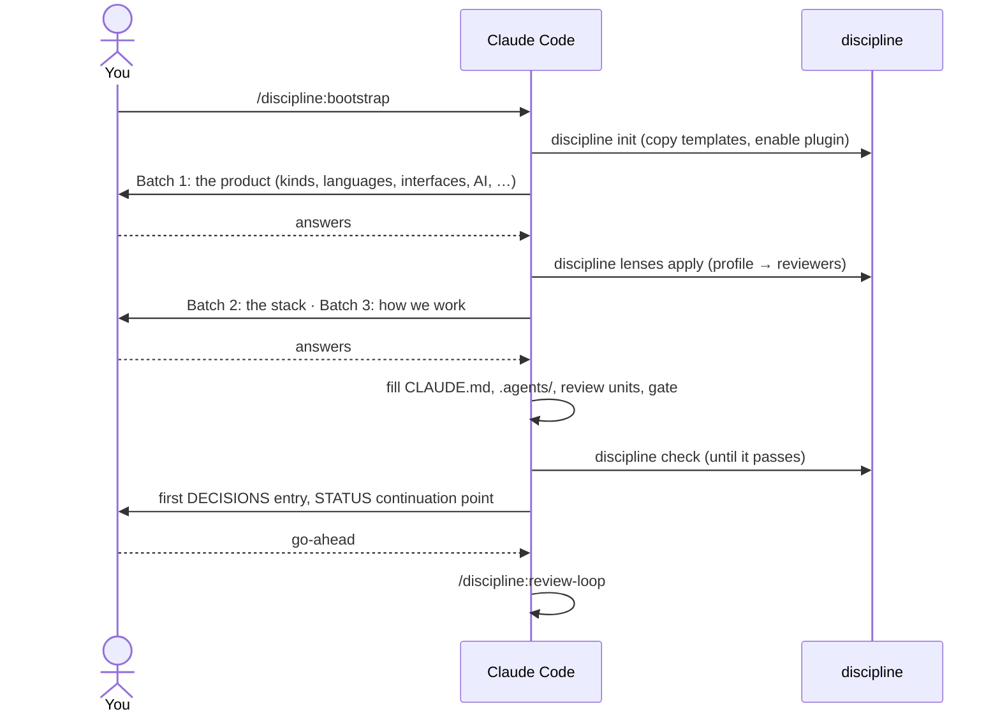
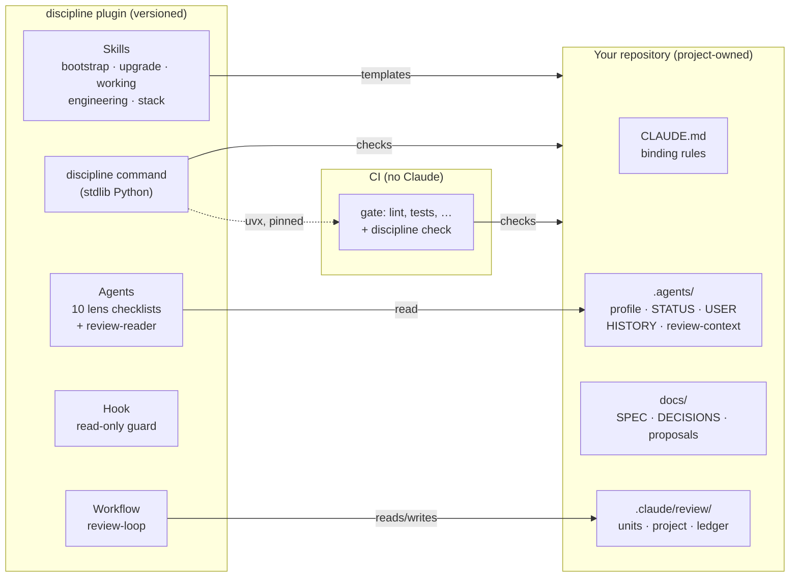
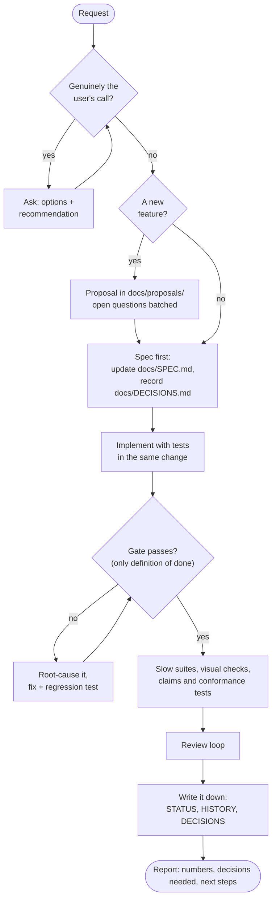
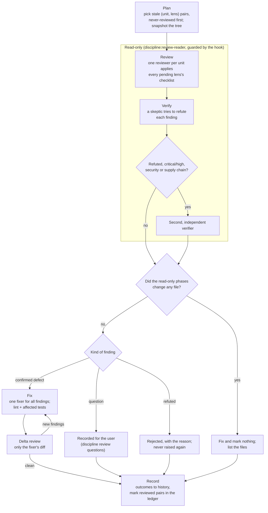
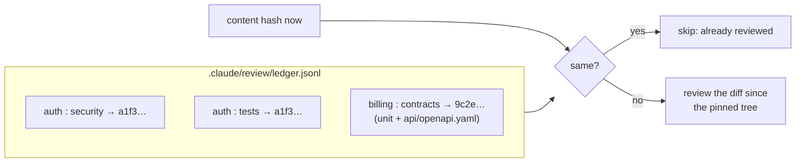
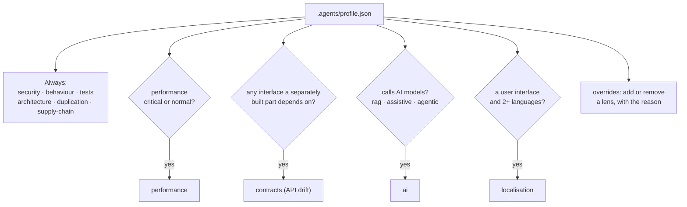
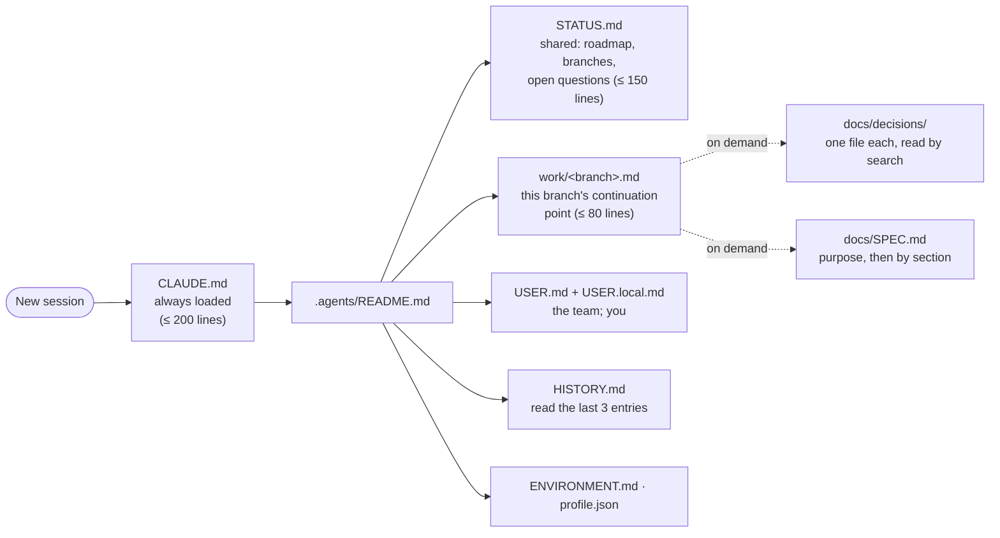
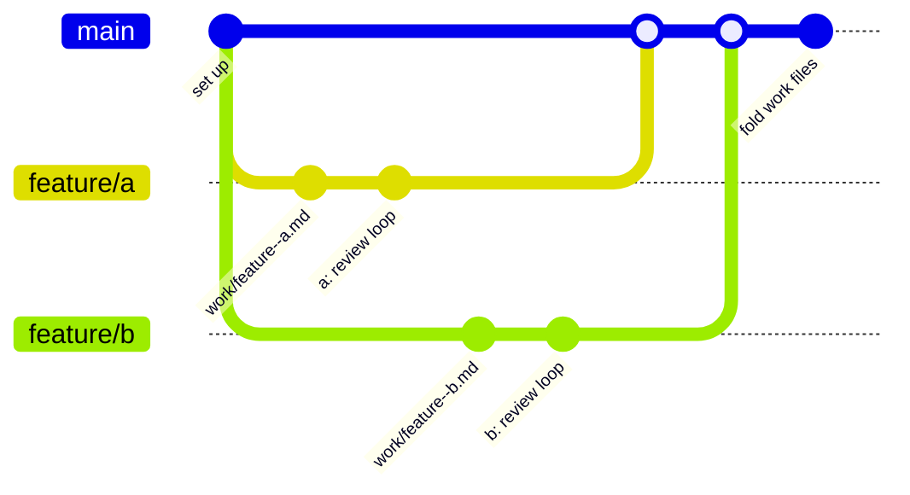

# discipline

**Coding agents are fast. discipline makes them dependable.**

An agent can write a feature in minutes. What it doesn't bring on its own is the discipline around
the code:
- remembering yesterday's decisions;
- knowing what "done" means;
- checking its work with fresh eyes;
- asking instead of guessing when the spec is silent;
- leaving the repository in a state the next session, or the next person, can pick up.

Without that, speed turns into drift:
- work declared finished because it compiles;
- tests that pass rather than check;
- product decisions made quietly in a fix;
- context lost to every crash or new session;
- a different set of habits in every repository.

**discipline** is that discipline, packaged as a Claude Code plugin. It is a working method you install
once and apply to any repository, whatever its stack:

- **Done means verified.** One deterministic gate is the only definition of done, and it runs the same
  in every session and in CI. Every failure is investigated to its root cause, never re-run until green.
- **Independent review, chosen for the product.** Read-only reviewers (security, behaviour, tests,
  architecture, performance, supply chain, API contracts, AI, localisation) look at the code through
  the lenses that fit what you're building. A skeptic verifies every finding, one fixer fixes them,
  and the fix is reviewed again. The reviewers can't change the code they review.
- **Intent stays with you.** The code is checked against the written spec and your recorded decisions.
  Where they don't settle a question, agents first check whether you've answered it before, and
  otherwise come back to you with options and a recommendation, rather than deciding for you or
  bending a test until it passes. When work can't wait, they proceed on the most conservative
  assumption, marked in the spec and flagged by the gate until you confirm it: no assumption becomes
  "the spec" unnoticed.
- **Evidence, not just assurance.** The adversarial review leaves a record in the repository: which
  code was reviewed through which lens and when, down to the exact content; every finding with its
  failure scenario, the fix, and the skeptic's reasoning; every rejection with its reason; every
  question and its answer. `discipline review evidence` turns it into a report for a pull request or an
  audit, and the regression tests each fix adds keep proving it.
- **Cheap enough to run all the time.** Review is incremental: unchanged code is never reviewed twice,
  and changed code is reviewed as a diff. So agents can run it on their own at the end of every phase.
- **Nothing important lives only in a chat.** Status, decisions, the spec and the review state are
  files in the repository. A crashed session, a new machine or a new teammate picks up exactly where
  things stopped.
- **Built for teams.** Branches keep their own progress, decisions are one file each, and the review
  state merges without conflicts. A review done on a branch still counts after the merge.
- **Principles you can cite.** Engineering principles (E1–E10) and stack-selection criteria (S1–S7)
  with stable numbers, so every decision and review finding says which one it rests on.

What it achieves: agents you can leave working, whose output you can trust and trace back to a reason,
in a repository that gets more consistent over time rather than less. It's opinionated about *how*
work gets done and *why* things are built a certain way, and neutral about the stack: no language,
framework or library is prescribed.

### In current terms

- **A spec-driven harness for Claude Code.** The spec is the contract agents work to, and discipline
  *enforces* it: code is reviewed against it, its rules can be pinned to tests, and nothing an agent
  assumes becomes part of it unnoticed.
- **A deterministic multi-agent review graph.** Reviewers fan out in parallel, one per unit; skeptics
  try to refute every finding; a single fixer works under strict rules; and a bounded fix-and-re-review
  cycle closes the loop. The control flow lives in code, not in the agents, so every run follows the
  same path and leaves evidence. A graph, deliberately not a swarm: no agent decides who acts next.
- **Context engineering by default.** Project memory lives in the repository, in files kept small on
  purpose: a snapshot of where things stand, decisions read by search, guides loaded only when needed.
- **Evals where the product uses AI.** Every prompt has an eval set with a facet per stage, checked by
  the gate.

### What it costs

discipline trades some speed for trust, and it's worth being plain about the trade:

- **Each feature takes longer to deliver, but is more likely to work first time.** The spec is updated
  first, features start as a proposal whose questions get answered, tests come in the same change, and
  nothing is done until the gate, the slow suites and the review loop have passed. An agent left to
  itself would declare it finished sooner, and you would find out later what it missed.
- **Reviews cost tokens and time.** A review run spawns a reviewer per unit, skeptics, a fixer and
  re-reviewers. As an illustration (one small sample project, not a benchmark): the first run over
  three units took about 13 agent calls and six minutes; a later run, after a small change, took 5.
  Incremental review keeps this down, since unchanged code is never reviewed again, but it isn't free.
- **Questions wait for people.** When the spec doesn't settle something that matters, the work on it
  waits for an answer instead of being guessed. That is the point, and it can still hold a feature up.

What the time buys back: less rework, fewer regressions (and fewer of the expensive kind: other tenants'
data, money, permissions), and no hours spent reconstructing why something is the way it is.
It pays off on products that live and change; for a throwaway prototype, a spike or hackathon code,
it's more process than the work needs.

- [Install](#install) · [Set up a repository](#set-up-a-repository) · [How the parts fit](#how-the-parts-fit)
- [The way of working](#the-way-of-working) · [The review loop](#the-review-loop) · [Reviewers](#reviewers-chosen-by-the-product)
- [Principles](#engineering-principles-and-stack-criteria) · [Handover files](#handover-files) · [Working as a team](#working-as-a-team) · [The gate](#the-gate)
- [The `discipline` command](#the-discipline-command) · [This repository](#this-repository)

## Install

The repository is a plugin marketplace called `chaordic`, with one plugin, `discipline`.

```sh
claude plugin marketplace add chaordic-io/discipline
claude plugin install discipline@chaordic
```

Or inside Claude Code: `/plugin install discipline --marketplace chaordic-io/discipline`.

Requirements: git, and Python 3.10+ (or [uv](https://docs.astral.sh/uv/), which fetches a Python when
there is none). The review loop is a Claude Code workflow, so it needs a plan with workflows enabled.

## Set up a repository

In the repository, run:

```
/discipline:bootstrap
```

The agent copies the templates, then asks three batches of questions, each with a recommended answer:
the **product** (its purpose, success measures and non-goals, which open the spec, and what kind of
product it is, which decides the reviewers), the **stack** (which decides the gate and tools) and
**how you work** (who commits, whether agents may run the review loop on their own and within which
usage limits, your standing preferences). It fills in the files, wires the gate, records
the decisions, and with your go-ahead runs a first review. Setting up also enables the plugin in the
repository's `.claude/settings.json`, so everyone who opens it works the same way.



When the plugin moves to a new version, `/discipline:upgrade` applies the [changelog](CHANGELOG.md)'s
migration notes to the repository.

## How the parts fit

The method is split by who owns each part. The **plugin** holds everything generic and versioned; the
**repository** holds only what belongs to the project; **CI** runs the same checks with no Claude
involved.



| Part | What it is |
|---|---|
| `/discipline:bootstrap` | Set a repository up: templates, questions, reviewers, gate. |
| `/discipline:upgrade` | Move a repository to a newer plugin version. |
| `/discipline:working` | The way of working (below). |
| `/discipline:engineering` | The engineering principles E1–E10. |
| `/discipline:stack` | Choosing a stack: criteria S1–S7, shapes by product kind, capability checklist, examples. |
| `/discipline:review-loop` | The review loop workflow. |
| `discipline:*-reviewer` agents | One generic checklist per lens; usable by hand too ("use discipline:security-auditor on the auth package"). |
| `discipline:review-reader` | The read-only agent the loop runs reviewers and verifiers in; a hook blocks its writes. |
| `discipline` | The command line tool: gate checks and the loop's bookkeeping. |

## The way of working

The user owns the product and makes product decisions; the main session clarifies, writes proposals and
specs, delegates, verifies and reports; subagents do bounded work from a self-contained brief; reviewers
are read-only. Every request goes through the same loop.



Some rules run through all of it:

- **Every failure is ours.** A red gate, a flaky test, a stray error log is investigated to its root
  cause and fixed with a regression test, whether this change caused it or not. Re-running until green
  is not a fix.
- **Decisions are written down when they are made**, not at the end, so a crash or a context reset
  loses nothing.
- **Verification has layers**, in order of cost: targeted checks while iterating, the gate, slow suites,
  screenshots for UI, claims tests (copy can't claim what the code doesn't do), conformance evidence for
  rule engines, the review loop.
- **Delegation** gives each agent a self-contained brief and never lets two agents edit the same area;
  several sessions on one repository split ownership by directory.

The full text is `/discipline:working`.

## The review loop

A deterministic multi-agent review graph: reviewers fan out in parallel, one per unit; skeptics try to
refute every finding; a single fixer works under strict rules; and a bounded fix-and-re-review cycle
closes the loop. The control flow lives in code, not in the agents, so every run follows the same path
and leaves evidence.

`/discipline:review-loop` reviews the repository a few units at a time. If you gave agents a standing
permission during setup (recorded in `CLAUDE.md`, with its limits), they run it on their own at the
end of each phase; otherwise they propose a run and wait for your go-ahead. Each **unit** is a feature or
package (roughly 10–40 files) with the **lenses** that apply to it. A ledger records the content hash
each (unit, lens) pair was last reviewed at, so unchanged code is never reviewed twice, and a changed unit
is reviewed as a diff since its last review.



What keeps it trustworthy and cheap:

- **Read-only reviewers, twice over.** Reviewers and verifiers run as `discipline:review-reader`, which
  has no editing tools; the plugin's hook blocks any write it tries through Bash; and `discipline review
  touched` checks afterwards that nothing changed.
- **No repeats.** Reviewers see every earlier finding in their unit. A rejected finding stays rejected
  unless the code changes so that the reason no longer holds.
- **Questions, not guesses.** Where the spec, the decisions and the proposals don't settle a behaviour,
  the reviewer raises a question with options and a recommendation. A verifier checks the documents
  really don't answer it. The fixer never sees questions; you answer them, the answer goes into the spec
  and DECISIONS, and `discipline review answer` closes them.
- **Lens context.** A unit can name files outside it that a lens depends on, such as the API contract
  for the contracts lens. Editing the contract re-queues the contract review of every unit that
  implements or consumes it, and nothing else.
- **Evidence.** Every outcome is recorded with its scenario, fix and verifier's reasoning, and tied to the
  exact code snapshot that was reviewed; the ledger records which content each lens reviewed, and when.
  `discipline review evidence [--since <date>]` prints it as Markdown, ready for a pull request
  description or an audit.
- **Usage guard.** `stopAt` (weekly %) and `stopAt5h` stop a run gracefully near your usage limits.



## Reviewers chosen by the product

The project profile (`.agents/profile.json`) records what kind of product this is. `discipline lenses
apply` turns it into lenses, so reviewers run only where they can find something.



| Lens | Looks for |
|---|---|
| security | Data isolation, authorization, authentication, injection, secrets, delivery headers. |
| behaviour | Code that contradicts the spec, the recorded decisions or the proposals; tests that pin the wrong values. Raises questions where the intent isn't written down. |
| tests | Untested behaviour and error paths, assertions that can't fail, missing property tests, mocks of real services. |
| architecture | Layering, duplicated concepts, transactions, schema constraints, observability (traces, quiet logs). |
| duplication | Copy-paste and near-duplicate business rules. |
| supply-chain | New dependencies, install-time code, pinning, licences, CI and image provenance. |
| performance | N+1 queries, unbounded work, hot spots, blocking I/O, client weight, at the expected sizes. |
| contracts | Implementation, consumers and spec against the API contract; breaking changes. |
| ai | Prompts and models as code, eval facets, output validation, prompt injection and tool permissions, data sent to providers. |
| localisation | Hard-coded text, locale-unaware formatting, catalogue gaps, translations that read as translations. |

The checklists are generic. Each starts by reading its section of `.agents/review-context.md`, which holds
the project's specifics (layering, expected sizes, contracts, languages, test commands).

## Engineering principles and stack criteria

Two separate lists with stable IDs, so decisions and review findings can cite them.

**How we build** (`/discipline:engineering`), for every change:

| | |
|---|---|
| E1 | Few moving parts |
| E2 | One source of truth per contract, everything else generated |
| E3 | Let the platform enforce the invariants |
| E4 | Exact domain types; country- and customer-specific rules as data |
| E5 | Test against the real thing |
| E6 | Dependencies are liabilities |
| E7 | Secure by default |
| E8 | Built for the profile's users from the start |
| E9 | Observable, with quiet logs |
| E10 | AI components engineered like code: versioned, evaluated, constrained |

**Choosing a stack** (`/discipline:stack`), once per stack decision:

| | |
|---|---|
| S1 | Fit the product, then the team |
| S2 | Few moving parts |
| S3 | Static types end to end, and strict |
| S4 | A healthy dependency ecosystem |
| S5 | Operable by the people who will run it |
| S6 | Reversible where it is cheap to be |
| S7 | The stack supports every engineering principle |

S7 links the two: a stack is a candidate only if it makes E1–E10 easy. The stack guide's capability
checklist shows, per ecosystem, the tools that fill each need; they are illustrations, not
recommendations.

## Handover files

A new or restarted session recovers its context from files in the repository, not from memory. What
every session reads is kept small on purpose.



| File | Rule |
|---|---|
| `.agents/STATUS.md` | What everyone shares: the roadmap and the shared open questions. A snapshot, rewritten in place. |
| `.agents/work/<branch>.md` | One per branch (`discipline work`): who works on it, what it owns, its continuation point and state. `discipline work --list` shows every branch in flight. Deleted when the branch merges. |
| `.agents/USER.md`, `USER.local.md` | The team's roles and shared preferences; each person's own, not committed. |
| `.agents/HISTORY.md` | A few lines per entry, added at the end; older entries move to `docs/history.md`. |
| `docs/decisions/` | One file per decision (`discipline decisions new`), each with `Area` and `Spec`, read by search; `docs/DECISIONS.md` is the generated index. |
| `CLAUDE.md` | Rules, not explanations. |

`discipline check` warns (never fails) when one of them passes its budget.

## Working as a team

Several people, each with their own sessions, work on branches. Nothing they share has to be merged by
hand:



| What | How it stays conflict-free |
|---|---|
| Where each branch stands, and who works on it | Its own work file, read across branches by `discipline work --list`; no branch edits a shared list. STATUS.md holds only the roadmap and shared questions. |
| Decisions | One file each; the index is regenerated (`discipline decisions index`), and the gate checks it. |
| Review state (ledger, history, trees) and HISTORY.md | Append-only, merged by keeping both sides (`merge=union` in `.gitattributes`, set by `discipline init`). |
| Review coverage | Keyed by content, not branch: what was reviewed on a branch stays reviewed after a clean merge; merged content that neither branch had is due again, as a diff. |
| Spec rule IDs | Two branches can both take "the next" ID; the gate fails on the duplicate, and the second branch renumbers. |
| Personal preferences | `USER.local.md`, not committed. |

The convention: review on the branch before its pull request, and let CI run the gate on every pull
request. Review questions go to the person `CLAUDE.md` names, and the standing permission to run the
loop can be given for everyone or per person.

## The gate

The gate is one command (`make check` or the stack's equivalent) and the only definition of done:
strict lint, tests with coverage thresholds and real services in containers, generated code current,
duplication, vulnerability and licence scans, and `discipline check`, pinned so that local runs and CI
agree:

```sh
uvx --from "git+https://github.com/chaordic-io/discipline@v1.0.0#subdirectory=plugins/discipline" discipline check
```

`discipline check` fails when a file belongs to no review unit (or to two), when the units disagree with
the profile, when a spec rule has no test that names it (if `specRules` is on), and when a prompt lacks
its eval set and facets (if the product calls models). Over-budget handover files are warnings.

## The `discipline` command

| Command | What it does |
|---|---|
| `discipline init [DIR]` | Copy the templates into a repository (never overwrites) and enable the plugin. |
| `discipline check` | The gate checks. |
| `discipline review plan · show · checklist · diff · touched · record · mark` | The review loop's bookkeeping (the workflow calls these). |
| `discipline review status · open · questions · answer` | Coverage per unit and lens; open findings; questions for you. |
| `discipline review evidence [--since DATE]` | The review's evidence as Markdown: coverage with dates, and every finding with its scenario, fix and verifier's reasoning. |
| `discipline lenses show · apply · check` | The lenses the profile selects, and why. |
| `discipline spec-rules` · `ai-evals` · `handover` | The individual checks, with details. |
| `discipline doc engineering · working · stack · bootstrap · upgrade` | The guides, as text. |
| `discipline work [--list]` | This branch's work file, created if missing; or every branch in flight, from git. |
| `discipline decisions new · index · check · search` | A new decision file; the index; search decisions and answered questions before asking. |
| `discipline assumptions` | Assumptions in the docs not yet confirmed. |

It acts on the git repository around the current directory. Inside Claude Code the plugin puts it on
the PATH; elsewhere, run it with `uvx` as above or `uv tool install` it.

## This repository

```
.claude-plugin/marketplace.json     the chaordic marketplace
plugins/discipline/
  .claude-plugin/plugin.json        the plugin manifest (version)
  skills/                           bootstrap (with templates/), upgrade, working, engineering, stack
  workflows/review-loop.js          the review loop
  agents/                           reviewer checklists and review-reader
  hooks/                            the read-only guard
  bin/discipline, src/discipline/   the command line tool (pyproject.toml)
  tests/                            the plugin's tests
CHANGELOG.md                        releases and migration notes
```

Developing:

```sh
cd plugins/discipline
python3 -m unittest discover -s tests     # or: uv run --no-project python -m unittest discover -s tests
uv build
claude plugin validate . && claude plugin validate ../..
```

Releasing: bump the version in `plugins/discipline/src/discipline/__init__.py` and
`plugins/discipline/.claude-plugin/plugin.json` (a test checks they agree), add a `CHANGELOG.md` entry
with its migration notes, and tag the commit `v<version>` (the pinned `uvx` line installs from the tag).

Changing the method: a lesson that applies beyond one project goes into `/discipline:working`; a new
engineering principle or stack criterion gets the next number (never renumber: decisions cite them); a
new lens needs a checklist in `agents/`, an entry in `CATALOGUE` and a rule in `decide`
(`src/discipline/lenses.py`), tests, and a row in the tables above.

## License

[MIT](LICENSE), © 2026 Chaordic.
